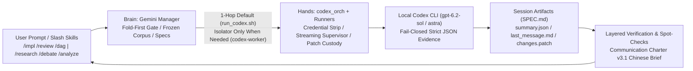

# Codex Orchestrator (`v3.2.0`)

A **Dual-Brain** orchestration plugin for **Google Antigravity** pairing **Gemini** (Principal Manager, Corpus Collector & Verifier) with **local OpenAI Codex CLI** (High-Execution Staff Implementer, Independent Reviewer & Red-Team Analyst) across software engineering (`/impl`, `/review`, `/dag`) and deep research / red-team debate / experiment analysis (`/research`, `/debate`, `/analyze`).

## What's New in `v3.2.0`

* **Decoupled Brain / Session / Hands Architecture (`SPEC.md`)**: Slimmed always-on `rules/AGENTS.md` to `<= 30` lines (~75% lower per-turn context tax), added root [`SPEC.md`](./SPEC.md) locking observable execution and conformance invariants, and extracted the zero-dependency Python foundation package `codex_orch/` (`env.py`, `schema_check.py`, `supervisor.py`, `compact_stdout.py`).
* **Verified Private-Index Patch Custody**: `run_codex_parallel.sh` pins `base_oid` per checkout, exports `changes.patch` and `changed_files` via a private `GIT_INDEX_FILE` (`base_oid -> final_tree_oid`, capturing worker-internal commits while honoring `.gitignore`), verifies `reconstructed_tree_oid == final_tree_oid` before worktree removal, uses atomic merge-check directories without `shutil.rmtree` fallback, and enforces `--dirty-policy fail|head`.
* **Fail-Closed Contracts & Streaming Supervision**: Rejects unsupported custom `--schema` keywords at preflight (exit `2`), exits `3` (`status: schema_error`) on structured validation mismatch, tracks parent-owned `invocation_id` with conditional `structured_valid` checks (preserving raw tasks), strips host SSH/cloud/platform credentials from child envs, adds monotonic `--timeout` (exit `124`) + opt-in `--stall-timeout` (exit `125`) process-group termination, classifies `paused_quota`, and guards against in-place self-hosting edits.
* **Cognitive Economics & Compact Stdout**: Defaults to 1-hop `run_codex.sh` (`codex-worker` runs with `inheritMcp: false` solely for multi-round repair / SSH / noisy log isolation), defaults `--stdout-mode auto` to a UTF-8-safe compact preview with artifact file pointers when `last_message.md > 4 KB` (keep `--stdout-mode full`), records `budget_exceeded` / `cmd_per_modified_file` / `last_message_bytes` telemetry, and adds stateless `CODEX_GUARD_PROFILE=pragmatic` (`<= 30` lines single-file existing code edits; `strict <= 10` lines stays default).
* **Antigravity Strict Validation Compliance**: Bundled `assets/logo.svg` and 3 starter `suggestedPrompts` passing `agy plugin validate --strict`.

## Architecture Overview



## Verification

Run the bundled zero-dependency conformance test suite and Antigravity strict plugin validation:

```bash
python3 -m unittest discover -s ~/.gemini/config/plugins/codex-orchestrator/tests -p 'test_*.py' -v
agy plugin validate --strict ~/.gemini/config/plugins/codex-orchestrator
```

## Repository Structure

| Path | Role |
| :--- | :--- |
| `plugin.json`, `assets/logo.svg` | Antigravity plugin manifest (`v3.2.0`) and icon (`agy plugin validate --strict` clean) |
| `SPEC.md` | Behavioral specification for Session/Hands exit codes, patch custody, and conformance |
| `hooks.json` | Root `PreToolUse` hook registration (`codex-delegate-guard`, `strict` default + `pragmatic` opt-in) |
| `rules/AGENTS.md` | Lean (`<= 30` lines) always-on Fold-First ladder, hard guardrails, and Communication Charter v3.1 pointer |
| `agents/codex-worker.md` | Context-compression subagent (`inheritMcp: false`) for multi-round repair & SSH/GPU isolation |
| `skills/codex-orchestrator/SKILL.md` | Full orchestration handbook (`v3.2`) |
| `skills/{impl,review,dag,research,debate,analyze}/SKILL.md` | Bundled slash skills |
| `skills/codex-orchestrator/scripts/` | `run_codex.sh`, `run_codex_parallel.sh`, `hook_delegate_guard.py`, and `codex_orch/` stdlib package |
| `skills/codex-orchestrator/references/` | 4 strict JSON schemas, Spec templates, and Communication Charter (`user-brief-template.md`) |
| `tests/test_plugin.py` | Zero-dependency conformance suite (manifest, guard profiles, fail-closed, supervision, compact stdout, real Git custody & concurrency) |
