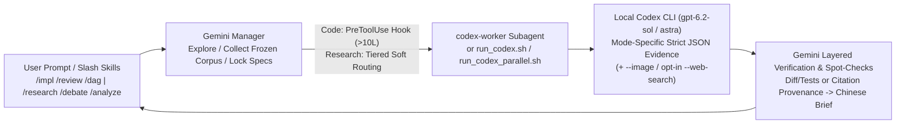

# Codex Orchestrator (`v3.1.0`)

A **General-Purpose Dual-Brain** plugin for **Google Antigravity** that pairs **Gemini** (Principal Manager, Corpus Collector & Decision-Maker) with **local OpenAI Codex CLI** (High-Execution Staff Implementer, Independent Reviewer & Red-Team Analyst) across both **software engineering** (`/impl`, `/review`, `/dag`) and **deep research / red-team debate / experiment analysis** (`/research`, `/debate`, `/analyze`).

> Looking for the terminal-focused Antigravity CLI (`agy`) edition? See the [`gemini-cli`](https://github.com/yukki555/codex-orchestrator/tree/gemini-cli) branch. This **`main` (Antigravity Desktop)** branch keeps full backward compatibility with all `v2.1`/`v3.0` workflows and upgrades to **`v3.1.0`** with the **Dynamic Communication Charter (`v3.1`)** (replacing rigid fixed 5-section templates with task-weight dynamic routing and strict factual-precision guardrails), alongside pluggable non-code profiles (`research`, `critique`, `analyze`), 4 strict JSON schemas, recursive schema validation, `--image` multimodal attachment, opt-in `--web-search`, and 6 bundled slash skills.

## Architecture Overview



* **Gemini (Principal Manager & Collector)**: Explores codebases, collects web/browser/remote evidence into frozen corpora (`/tmp/codex-orchestrator/<task-id>/corpus/`), aligns tradeoffs with the user, locks shared cross-module contracts and concise Specs, orchestrates `codex-worker` or parallel runners, runs layered verification & citation spot-checks, and synthesizes raw Codex outputs into calm, precise Chinese replies using the **Communication Charter (`v3.1`)** dynamic routing (`consult`, lightweight code changes, heavyweight delivery / `review`, and `research` / `critique` / `analyze`).
* **Local Codex CLI (Implementer, Reviewer & Red-Team Analyst)**: Executes all new local code files, `> 10`-line logic edits, refactors, test authoring, deep diagnostics, Git diff QA, and read-only structured research / blind critique / experiment audits via non-interactive `codex exec`.
* **Hook Guardrail (`codex-delegate-guard`)**: `PreToolUse` hook prevents Gemini from bypassing Codex on non-trivial local source edits while allowing docs/configs, `/tmp/`, `~/.gemini/`, `<= 10`-line micro-edits, and explicit user opt-outs (`不用codex` / `skip codex` / `你直接改`). Read-only research/debate/analysis tasks stay hook-free and use tiered soft routing.

## Key Features (`v3.1.0`)

* **Dynamic Communication Charter (`v3.1`)**: Replaces fixed one-size-fits-all 5-section templates with 5 expression & factual-fidelity iron rules (restrained architectural tone, zero qualifier/math distortion, upfront verification/evidence watermarks, zero slot-filling hallucination, lightweight `file:line`/`source_id` anchors) plus 4 task-weight dynamic routes (`consult`, lightweight 1–2 file fixes, heavyweight delivery / `review`, and `research` / `critique` / `analyze`).

* **General-Purpose Pluggable Profiles & 4 Strict JSON Schemas**:
  * **Coding (`codex-output-schema.json`)**: `implement`, `consult`, `review`, `resume` with managed detached Git worktrees, `changes.patch` export (including untracked files via `git add -N`), and sequential stacked `merge_check` (`merge_ok`).
  * **Research / Debate / Experiment Analysis**: `research` (`research-output-schema.json`), `critique` (`critique-output-schema.json`), and `analyze` (`analysis-output-schema.json`) in read-only sandboxes that work cleanly on non-Git `corpus/` directories.
  * **Recursive Schema Validation**: `structured_valid` validates `last_message.md` recursively against the active JSON Schema (`type`, `required`, `properties`, `additionalProperties`, `items`, `enum`) instead of merely checking JSON syntax.
* **Offline Reproducible Corpora + Opt-In Live Web Search (`--web-search`)**: Defaults to offline execution with explicit `-c web_search="disabled"` so frozen-corpus audits remain reproducible; pass `--web-search` (or per-task `"web_search": true` in parallel manifests) to invoke `codex --search exec` for live web lookup.
* **Multimodal Image Attachments (`-i` / `--image <FILE>`)**: Repeatable chart, figure, or screenshot attachment across `consult`, `implement`, `research`, `critique`, `analyze`, `resume`, and `review` (auto-routes `review` via `read-only-exec`), plus per-task `"images": [...]` in parallel manifests.
* **Decoupled Speed & Reasoning Routing (`--speed`)**: Automatically enables `service_tier="fast"` (`2x` speed) for `low`/`medium` effort across both `gpt-6.2-sol` and `gpt-6.2-astra`, while keeping `high`+ at `default` unless `--speed fast` is passed (`ultrafast` supported on `gpt-6.2-sol`, auto-downgrades safely on `gpt-6.2-astra`).
* **Zero-Intrusion Desktop Config Isolation & Telemetry**: Defaults to `--ignore-user-config` and `--ignore-rules` (reusing `~/.codex` auth while avoiding macOS sandbox permission errors and noisy Desktop MCP configs), auto-inherits `model`/`add_dirs` on `resume`, and extracts `partial_progress` on failures/timeouts.

## Prerequisites & Installation

1. **Google Antigravity** (global plugin discovery under `~/.gemini/config/plugins/`).
2. **OpenAI Codex CLI** (`codex` >= `0.171.0`, e.g. `npm install -g @openai/codex@latest`), already signed in (`~/.codex/auth.json`).
3. `python3`, `git`, and macOS/Linux `bash` (`3.2+`).

Clone directly into your global Antigravity plugins directory:

```bash
mkdir -p ~/.gemini/config/plugins
git clone https://github.com/yukki555/codex-orchestrator.git ~/.gemini/config/plugins/codex-orchestrator
```

Antigravity automatically discovers `plugin.json`, global policy rules (`rules/AGENTS.md`), hooks (`hooks.json`), subagents (`agents/codex-worker.md`), and all 7 bundled skills (`skills/*/SKILL.md`).

## Slash Skills & Usage

In normal Antigravity sessions, describe your engineering or research task in natural language—or invoke a bundled slash skill directly:

| Command / Feature | Category | Purpose |
| :--- | :--- | :--- |
| `/impl <task>` | Code | Explore relevant code -> write `spec.md` -> `codex-worker` / `run_codex.sh implement --structured` -> verify -> Chinese brief. |
| `/review` | Code | Inspect uncommitted Git changes in one structured pass (`run_codex.sh review --uncommitted --structured`) + spot-check `file:line` -> Chinese risk brief. |
| `/dag <task>` | Code | Stage 0 `contract.md` + manifest -> Stage 1 `run_codex_parallel.sh` managed worktrees + `merge_check` -> `git apply` -> Stage 2 integration -> Stage 3 parallel test & review. |
| `/research <topic>` | General | Stage 0 freeze web/local sources into `corpus/` -> Stage 1 parallel Codex `research` (+ Antigravity `research`/`browser`) -> Stage 2 optional blind `critique` -> Stage 3 source spot-check & Chinese decision brief. |
| `/debate <proposal>` | General | Neutralize proposal (strip author bias) -> independent Codex `critique` red-team pass -> adjudicate P0/P1 challenges -> Chinese decision matrix. |
| `/analyze <exp>` | Research / Data | Collect local/remote logs & plots into `corpus/` -> Codex `analyze` (+ `--image`) checking theory/code/metrics consistency -> spot-check numbers -> Chinese brief. |
| `codex-worker` | Subagent | Isolates multi-round repair loops (`<= 2` rounds) or remote SSH/GPU verification out of the main conversation. |

### Direct CLI Examples

```bash
SCRIPTS=~/.gemini/config/plugins/codex-orchestrator/skills/codex-orchestrator/scripts

# 1. Default medium+fast structured implementation
"$SCRIPTS/run_codex.sh" implement \
  --dir "/path/to/repo" --add-dir "/path/to/tests" \
  --structured --timeout 240 \
  --spec /tmp/codex-orchestrator/task-1/spec.md \
  --out-dir /tmp/codex-orchestrator/task-1/implement

# 2. Structured deep research on a frozen non-Git corpus (+ optional chart & opt-in live search)
"$SCRIPTS/run_codex.sh" research \
  --dir /tmp/codex-orchestrator/topic-1/corpus --structured --ephemeral \
  --image /tmp/codex-orchestrator/topic-1/corpus/chart.png \
  --spec /tmp/codex-orchestrator/topic-1/spec-research.md \
  --out-dir /tmp/codex-orchestrator/topic-1/research

# 3. Blind red-team critique with high effort + fast tier
"$SCRIPTS/run_codex.sh" critique \
  --dir /tmp/codex-orchestrator/debate-1 --structured --effort high --speed fast --ephemeral \
  --spec /tmp/codex-orchestrator/debate-1/spec-critique.md \
  --out-dir /tmp/codex-orchestrator/debate-1/critique

# 4. Experiment & code consistency analysis with plots
"$SCRIPTS/run_codex.sh" analyze \
  --dir "/path/to/repo" --structured --image /tmp/codex-orchestrator/exp-1/loss.png \
  --spec /tmp/codex-orchestrator/exp-1/spec-analyze.md \
  --out-dir /tmp/codex-orchestrator/exp-1/analyze

# 5. Parallel heterogeneous research + critique (or worktree implement) manifest
"$SCRIPTS/run_codex_parallel.sh" \
  --out-dir /tmp/codex-orchestrator/topic-1/parallel \
  --mode research --structured --max-parallel 3 \
  --dir /tmp/codex-orchestrator/topic-1/corpus --timeout 240 \
  --manifest /tmp/codex-orchestrator/topic-1/manifest.json
```

## Verification

Run the bundled zero-dependency test suite:

```bash
python3 -m unittest discover -s ~/.gemini/config/plugins/codex-orchestrator/tests -p 'test_*.py' -v
```

## Repository Structure

| Path | Role |
| :--- | :--- |
| `plugin.json` | Antigravity plugin manifest (`v3.1.0`) |
| `hooks.json` | Root `PreToolUse` hook registration (`codex-delegate-guard`, code writes only) |
| `rules/AGENTS.md` | Always-on Dual-Brain delegation, tiered research routing, DAG gate, and Communication Charter (`v3.1`) |
| `agents/codex-worker.md` | Dedicated Codex execution & verification subagent definition |
| `skills/codex-orchestrator/SKILL.md` | Full orchestration workflow handbook (`v3.1`) |
| `skills/{impl,review,dag,research,debate,analyze}/SKILL.md` | Bundled slash skills covering code & general research/debate/analysis workflows |
| `skills/codex-orchestrator/scripts/` | `run_codex.sh`, `run_codex_parallel.sh`, and `hook_delegate_guard.py` |
| `skills/codex-orchestrator/references/` | 4 strict JSON schemas (`codex`, `research`, `critique`, `analysis`), Spec templates, and the `v3.1` Communication Charter (`user-brief-template.md`) |
| `tests/test_plugin.py` | Unit tests covering manifests, `hooks.json`, `agents`, 7 skills, 4 schemas, stub-Codex CLI/parallel routing, and hook guard |
