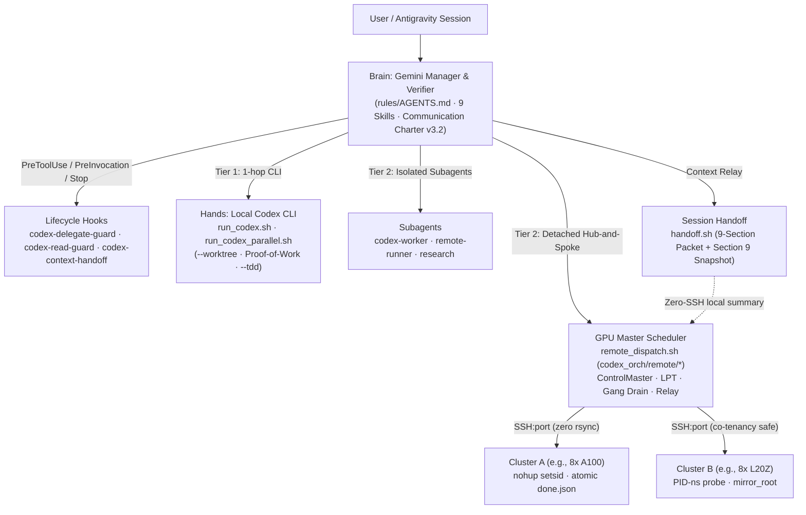

<div align="center">


# Codex Orchestrator

**Dual-Brain Engineering, Research, Session Continuity & Multi-Server GPU Orchestration for Google Antigravity**

[](./plugin.json)
[](#-requirements--installation)
[](#-skills--agents)
[](#-verification--conformance)
[](./SPEC.md)

[Architecture](#-architecture) · [Quick Start](#-quick-start) · [Skills & Agents](#-skills--agents) · [GPU Master Scheduler](#-multi-server-gpu-master-scheduler-dispatch) · [Session Handoff](#-context-hygiene--session-handoff-handoff) · [Verification](#-verification--conformance) · [Changelog](#-release-history)

</div>

---

## Overview

**Codex Orchestrator** (`v3.9.0`) is a zero-dependency **Dual-Brain** plugin for **Google Antigravity** that pairs:

- **Gemini** as **Principal Manager, Corpus Collector & Verifier** — owns specifications, objective artifact inspection, host-side Proof-of-Work, and synthesis.
- **Local OpenAI Codex CLI** as **Staff Implementer, Independent Reviewer & Red-Team Analyst** — executes scoped patches in isolated worktrees, structured reviews, parallel DAG tasks, and blind critiques.
- **Pure-Stdlib Local Master Scheduler** (`scripts/remote_dispatch.sh`) — dynamically schedules heterogeneous multi-server GPU sweeps across air-gapped clusters without `rsync`, static wave barriers, or per-tick LLM token overhead.

> [!NOTE]
> Zero third-party Python dependencies (`python3 -I -B` stdlib + POSIX `bash`/`ssh`/`tar` only). Strict fail-closed exit codes, immutable per-attempt artifacts, and automatic secret redaction throughout.

---

## Key Capabilities

| Pillar | What It Solves | Highlights |
| :--- | :--- | :--- |
| **Dual-Brain Engineering** | Eliminates single-model blind spots and unverified edits | `/impl`, `/review`, `/dag`, trusted `.codex-orchestrator.json`, host-side Proof-of-Work (`verification.json`), opt-in cross-model `--tdd`, private-index patch custody |
| **Multi-Server GPU Dispatch** | Eliminates static `wait_all` barriers, cross-cluster speed skew, and shared-GPU collisions | `/dispatch` (`remote_dispatch.sh`): LPT + critical-path work-stealing, DSW/Docker PID-namespace external GPU detection, multi-GPU gang drain (`draining_for`), live `add-tasks`, `stall_timeout_s` watchdog, resumable SHA256 `relay_inputs`, `mirror_root` + lightweight pull-back |
| **Deep Research & Analysis** | Grounds design trade-offs and experiment claims in frozen evidence | `/research`, `/debate`, `/analyze`, offline frozen `corpus/`, structured JSON schemas, reusable read-only `/run-workflow` templates |
| **Context Hygiene & Handoff** | Prevents context rot and lost state across long-horizon sessions | Slim cold-start policy, `codex-read-guard`, two-tier `read_noise` & `remote_noise` nudges, lossless 9-section `/handoff` packets with active `dispatch_runs` snapshots |

---

## Architecture



### Fold-First Cost Ladder

| Tier | Route | When to Use |
| :--- | :--- | :--- |
| **Tier 0** | Main Loop | Single-fact lookups, docs/config edits, or micro-fixes (`<= 10` lines under `strict`, `<= 30` under `CODEX_GUARD_PROFILE=pragmatic`). |
| **Tier 1** | Direct 1-Hop `run_codex.sh` | Clean single-shot `implement`, `consult`, `review --structured`, `research`, `critique`, or `analyze` with zero subagent hop overhead. |
| **Tier 2** | Specialized Fan-Out / Isolators | `/dag` (`>= 3` loosely coupled code files), `/dispatch` (multi-server dynamic GPU sweeps), `remote-runner` (multi-turn SSH/sync), `research` (`>= 3` files or `> 20 KiB` comprehension), `codex-worker` (`<= 2` repair rounds / noisy logs), `/research` & `/debate` (parallel slices). |

---

## Skills & Agents

### Slash Commands (9 Skills)

| Skill | Entrypoint | Purpose |
| :--- | :--- | :--- |
| **`/impl`** | [`skills/impl/SKILL.md`](./skills/impl/SKILL.md) | Spec-first scoped implementation via Codex CLI (`--worktree`, Proof-of-Work, optional `--tdd`) and independent verification. |
| **`/review`** | [`skills/review/SKILL.md`](./skills/review/SKILL.md) | Single-pass structured review (`review-output-schema.json`) on uncommitted Git changes with severity-ranked findings. |
| **`/dag`** | [`skills/dag/SKILL.md`](./skills/dag/SKILL.md) | Parallel multi-module Codex workflow with shared contracts, auto-injected sibling ownership table, and `base_oid` patch custody. |
| **`/dispatch`** | [`skills/dispatch/SKILL.md`](./skills/dispatch/SKILL.md) | Centralized dynamic multi-server GPU scheduler with work-stealing, DAG isolation, co-tenancy safety, live `add-tasks`, and artifact relay. |
| **`/research`** | [`skills/research/SKILL.md`](./skills/research/SKILL.md) | 4-stage multi-model deep research with frozen source corpus, parallel structured citations, optional blind critique, and source spot-checks. |
| **`/debate`** | [`skills/debate/SKILL.md`](./skills/debate/SKILL.md) | Dual-model blind red-team critique (`P0–P3`) and decision matrix from a de-biased neutral brief. |
| **`/analyze`** | [`skills/analyze/SKILL.md`](./skills/analyze/SKILL.md) | Structured experiment, log, figure, and paper-code consistency verification over a read-only corpus. |
| **`/handoff`** | [`skills/handoff/SKILL.md`](./skills/handoff/SKILL.md) | Context telemetry inspection, fail-closed 9-section Handoff Packet generation, and lossless successor conversation launch. |
| **Core** | [`skills/codex-orchestrator/SKILL.md`](./skills/codex-orchestrator/SKILL.md) | Fold-first routing policy, guardrails, and Communication Charter v3.2 verification loop. |

### Dedicated Agents (2)

- **`codex-worker`** ([`agents/codex-worker.md`](./agents/codex-worker.md)) — Isolates multi-round Codex repair loops (`<= 2` rounds), noisy local test/build output, and `/run-workflow` read-only slices.
- **`remote-runner`** ([`agents/remote-runner.md`](./agents/remote-runner.md)) — Isolates SSH probing, cross-host transfers, cluster operations, and single-wave Launch-Verify-Return checks.

---

## Requirements & Installation

### Prerequisites

- **Google Antigravity** (with plugin support enabled)
- **Python 3.9+** (standard library only; zero `pip install` needed)
- **OpenAI Codex CLI** (`codex` available on `PATH` and authenticated locally)
- **POSIX `bash`, `ssh`, `tar`** (for `/dispatch` remote scheduling; `rsync` is **not** required)

### Install

Clone directly into your Antigravity plugins directory and validate:

```bash
git clone https://github.com/yukki555/codex-orchestrator.git \
  ~/.gemini/config/plugins/codex-orchestrator

agy plugin validate --strict ~/.gemini/config/plugins/codex-orchestrator
```

> [!TIP]
> For `/dispatch`, keep real cluster SSH targets and host paths **outside** the plugin repository at `~/.config/codex-orchestrator/clusters.json` (or set `CODEX_ORCH_CLUSTER_CONFIG` / `--cluster`). Start from [`cluster-inventory-example.json`](./skills/codex-orchestrator/references/cluster-inventory-example.json).

---

## Quick Start

Set the scripts path once:

```bash
SCRIPTS=~/.gemini/config/plugins/codex-orchestrator/skills/codex-orchestrator/scripts
```

### 1. Scoped Implementation with Host-Side Proof-of-Work

```bash
"$SCRIPTS/run_codex.sh" implement \
  --dir "/path/to/repo" --worktree --structured --timeout 240 --stall-timeout 120 \
  --verify-cmd '["python3", "-m", "unittest", "discover", "-s", "tests"]' \
  --spec /tmp/codex-orchestrator/task-1/spec.md \
  --out-dir /tmp/codex-orchestrator/task-1/implement
```

### 2. Multi-Server Dynamic GPU Sweep (`/dispatch`)

```bash
# 1. Validate schema, DAG, placeholders, and live GPU / disk headroom
"$SCRIPTS/remote_dispatch.sh" validate --manifest ./jobs.json
"$SCRIPTS/remote_dispatch.sh" plan --manifest ./jobs.json --live-probe --format table

# 2. Launch-Verify-Return: sync code (tar over SSH), dispatch Wave 1, detach controller
"$SCRIPTS/remote_dispatch.sh" start --manifest ./jobs.json --run-dir ./runs/sweep-01 --sync --caffeinate

# 3. Zero-SSH local inspection & live operations
"$SCRIPTS/remote_dispatch.sh" status --run-dir ./runs/sweep-01 --format table
"$SCRIPTS/remote_dispatch.sh" add-tasks --run-dir ./runs/sweep-01 --tasks ./wave2.json
"$SCRIPTS/remote_dispatch.sh" cordon --run-dir ./runs/sweep-01 --host cluster-b
"$SCRIPTS/remote_dispatch.sh" stop --run-dir ./runs/sweep-01 --kill-remote
```

### 3. Lossless Session Handoff (`/handoff`)

```bash
"$SCRIPTS/handoff.sh" inspect
"$SCRIPTS/handoff.sh" create \
  --packet /tmp/codex-orchestrator/handoff-draft.md \
  --workspace "/path/to/repo" \
  --artifact-dir /tmp/codex-orchestrator/artifacts \
  --resume-mode auto
```

See [`cli-reference.md`](./skills/codex-orchestrator/references/cli-reference.md) for all subcommands, exit codes, declarative profiles, and environment variables.

---

## Multi-Server GPU Master Scheduler (`/dispatch`)

Designed for real heterogeneous research clusters (e.g., 8×A100 + 8×L20Z across isolated networks without `rsync`, shared multi-tenant nodes, and volatile `/tmp` scratch volumes):

- **Dynamic Work-Stealing & LPT Scheduling**: Ranks ready DAG tasks by `(priority DESC, downstream_deps DESC, gpus DESC, est_duration_s DESC)` with locality scoring (`prefer_dep_host`, `require_dep_host`, `prefer_key:<k>`, `speed_weight`) — faster clusters naturally pull more jobs with zero static wave barriers.
- **Multi-GPU Gang Reservation (`draining_for`)**: Automatically reserves and drains the fastest-clearing eligible host for multi-GPU (`gpus > 1`) jobs so 1-GPU sweeps cannot starve DDP training while other hosts remain saturated; auto-releases if external load drops usable GPUs below `G`.
- **Container PID-Namespace-Safe Co-Tenancy**: Single-RPC probes inspect `nvidia-smi`, `ps`, and `/proc/<pid>/fd` `/dev/nvidia<idx>` holders on leased GPUs — eliminating false self-collisions inside DSW/Docker containers while accurately detecting foreign jobs under `skip_gpu`, `preempt_gpu`, `yield_host`, and `ignore`.
- **Resumable SHA256 Cross-Host Relay (`relay_inputs`)**: Streams declared checkpoints `Source -> Hub -> Target` outside `state.lock` with target cache hits, byte-offset + prefix-SHA256 resume, `max_bytes` hard caps, and transparent `{dep.<id>.out_dir}` / `{inputs_dir}` resolution.
- **Resilience & Storage Safety**: Cross-host `done_markers` pre-check skips already-finished tasks before launch; `stall_timeout_s` watchdog monitors `task.log` growth + GPU utilization; `mirror_root` persists lightweight outputs off volatile `/tmp`; `retry_on_host_lost=false` prevents split-brain re-runs; `start --resume` adopts surviving remote PGIDs after local sleep or disconnect.

---

## Context Hygiene & Session Handoff (`/handoff`)

- **Guard Hooks (`hooks.json`)**:
  - `codex-delegate-guard` (`PreToolUse`) — routes new code files and substantial code edits through Codex unless the user explicitly opts out.
  - `codex-read-guard` (`PreToolUse`) — blocks unbounded main-loop reads above `20 KiB` and guides callers to bounded ranges (`<= 450` lines), targeted extraction, or `research`.
  - `codex-context-handoff` (`PreInvocation` + `Stop`) — tracks dual-constraint model-aware watermarks (`Soft = min(200K, 45% × cpLimit)`, `Hard = min(300K, 65% × cpLimit)`), checkpoint-scoped `read_noise` / `remote_noise` nudges, and optional chain-inherited `auto` handoff.
- **Active Dispatch Continuity**: Detached `remote_dispatch.sh` controllers never block the `/handoff` Quiescence Gate and auto-register in `$PLUGIN_DATA/dispatch_runs.json` so `handoff.sh create` embeds a zero-SSH live `dispatch_runs` summary into Section 9 (or pin specific runs with `--dispatch-run-dir`).
- **Verification Discipline**: Every delegated run follows **Communication Charter v3.2** ([`user-brief-template.md`](./skills/codex-orchestrator/references/user-brief-template.md)) — inspect `git diff --stat`, key hunks, and host `verification.json` before reading model prose, preserve exact evidence anchors, and strip internal shorthand.

---

## Verification & Conformance

Run the full zero-dependency offline test suite and strict Antigravity plugin validator:

```bash
PYTHONDONTWRITEBYTECODE=1 python3 -B -m unittest discover \
  -s ~/.gemini/config/plugins/codex-orchestrator/tests -p 'test_*.py' -v

agy plugin validate --strict ~/.gemini/config/plugins/codex-orchestrator
```

- **`tests/test_plugin.py`** — plugin manifest, doc-line/byte budgets, hook contracts, Codex wrappers, patch custody, TDD gates, and repo hygiene (zero `__pycache__`, zero personal paths).
- **`tests/test_handoff.py`** — transcript telemetry, read/remote noise nudges, fail-closed packet validation, ConversationService relay, and Section 9 `dispatch_runs` snapshots.
- **`tests/test_remote_dispatch.py`** — schemas, heterogeneous work-stealing, DAG isolation, DSW PID-namespace probes, co-tenancy policies, gang drain, `add-tasks`, `stall_timeout_s`, and resumable SHA256 `relay_inputs`.

---

## Repository Structure

| Path | Role |
| :--- | :--- |
| [`plugin.json`](./plugin.json), [`assets/logo.svg`](./assets/logo.svg) | Antigravity plugin manifest (`v3.9.0`) and brand icon |
| [`SPEC.md`](./SPEC.md) | Formal behavioral specification (exit codes, patch custody, Proof-of-Work, TDD, handoff, and remote GPU scheduler) |
| [`TODO.md`](./TODO.md) | Roadmap and milestone tracking |
| [`hooks.json`](./hooks.json) | Root `PreToolUse` (`codex-delegate-guard`, `codex-read-guard`) and `PreInvocation` + `Stop` (`codex-context-handoff`) registrations |
| [`rules/AGENTS.md`](./rules/AGENTS.md) | Slim (`<= 30` lines) always-on Fold-First ladder, guardrails, and Communication Charter v3.2 pointer |
| [`agents/`](./agents) | Subagent definitions (`codex-worker.md`, `remote-runner.md`) |
| [`skills/`](./skills) | 9 skills (`codex-orchestrator`, `impl`, `review`, `dag`, `dispatch`, `research`, `debate`, `analyze`, `handoff`) |
| [`skills/codex-orchestrator/config/profiles.json`](./skills/codex-orchestrator/config/profiles.json) | Declarative model, effort, speed, command-budget, schema, and `context_handoff` routing table |
| [`skills/codex-orchestrator/scripts/`](./skills/codex-orchestrator/scripts) | Thin shims (`run_codex.sh`, `run_codex_parallel.sh`, `remote_dispatch.sh`, `handoff.sh`, hook wrappers) + zero-dependency `codex_orch/` package |
| [`skills/codex-orchestrator/workflows/`](./skills/codex-orchestrator/workflows) | Reusable Antigravity `/run-workflow` read-only templates (`research_parallel.py`, `debate_multi_critic.py`) |
| [`skills/codex-orchestrator/references/`](./skills/codex-orchestrator/references) | Draft-07 JSON schemas, `cluster-inventory-example.json`, `cli-reference.md`, Spec/Handoff templates, and [`user-brief-template.md`](./skills/codex-orchestrator/references/user-brief-template.md) |
| [`tests/`](./tests) | Offline stdlib conformance suites (`test_plugin.py`, `test_handoff.py`, `test_remote_dispatch.py`) |

---

## Release History

### `v3.9.0` & Remote Master Scheduler (Milestones 1 & 2)

- **Remote Multi-Server GPU Master Scheduler (`/dispatch`, `remote_dispatch.sh`)**: Full hub-and-spoke dynamic scheduler with ControlMaster pooling, LPT + critical-path work-stealing, DSW/Docker PID-namespace external GPU accounting, multi-GPU gang reservation (`draining_for`), live `add-tasks` injection, cross-host `done_markers` pre-check, `stall_timeout_s` watchdog, resumable SHA256 `relay_inputs`, `mirror_root` + lightweight pull-back, readable `--format table` views, `stop --kill-remote` state cleanup, and `/handoff` Section 9 `dispatch_runs` snapshots.
- **Context Hygiene (`v3.9.0`)**: Slim cold-start policy and skills (`cli-reference.md` offload), two-tier `read_noise` nudges, `codex-read-guard` `PreToolUse` hook, and errored-read telemetry exclusion.

<details>
<summary><strong>Earlier Releases (<code>v3.8.0</code> – <code>v3.5.0</code>)</strong></summary>

- **`v3.8.0` — Dispatch Clarity & Synthesis Verification**: `consult` defaults to `gpt-6.2-sol` with declarative `--verbosity` and Output Clarity Contract; structured `review-output-schema.json`; `--stdout-mode facts` default for `implement`; **Communication Charter v3.2** ([`user-brief-template.md`](./skills/codex-orchestrator/references/user-brief-template.md)) with objective-first verification and the Synthesis Firewall.
- **`v3.7.0` — Horizontal Subagent Denoising & Chain Auto-Handoff**: Dedicated `remote-runner` and built-in `research` routing, checkpoint-scoped `PreInvocation` noise nudges (`CODEX_NOISE_NUDGE`), dual-track Handoff Packets, and chain-inherited `handoff-mode:auto`.
- **`v3.6.0` — Native Antigravity Session Handoff**: Zero-dependency `context_telemetry.py`, `codex-context-handoff` lifecycle hooks, lossless 9-section Handoff Packet + `ConversationService` relay engine with anti-split-brain and `max_hops` circuit breakers.
- **`v3.5.1` — Headwind Reliability Patch**: Descendant process-group cleanup on timeout/cancellation, deep `resume` summary lookup, and large/timed-out resume warnings.
- **`v3.5.0` — Pure-Python `codex_orch/` Execution Kernel**: Consolidated `run_codex.sh` and `run_codex_parallel.sh` onto `exec python3 -I -B`, declarative `config/profiles.json`, immutable per-attempt artifacts, trusted `.codex-orchestrator.json` + host-side Proof-of-Work, opt-in cross-model `--tdd`, DAG ownership tables, and reusable `/run-workflow` templates.

</details>
