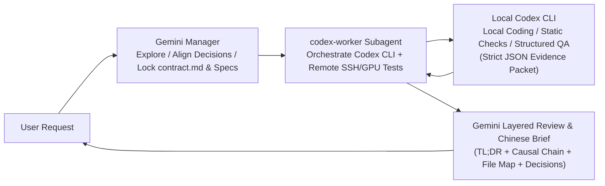

# Codex Orchestrator (`v2.1.0`)

A **Manager / Implementer Dual-Brain** plugin for Google Antigravity that pairs **Gemini** (Principal Engineering Manager & Decision-Maker) with **local OpenAI Codex CLI** (High-Execution Staff Implementer & Independent Reviewer).

## Architecture Overview



* **Gemini (Manager)**: Explores codebases, aligns architecture tradeoffs with the user, locks shared cross-module contracts (`/tmp/codex-orchestrator/<task-id>/contract.md`) and concise Specs, orchestrates `codex-worker` / parallel runners, performs layered verification, and rewrites terse Codex logs into clear human-readable Chinese briefs.
* **Local Codex CLI (Implementer & Reviewer)**: Executes all new local code files, `> 10`-line logic edits, refactors, test authoring, deep diagnostics, and Git diff QA cleanly via non-interactive `codex exec`.
* **Hook Guardrail (`codex-delegate-guard`)**: `PreToolUse` hook prevents Gemini from bypassing Codex on non-trivial local source edits while allowing docs/configs, `/tmp/`, `~/.gemini/`, `<= 10`-line micro-edits, and explicit user opt-outs (`不用codex` / `skip codex` / `你直接改`).

## Key Features (`v2.1.0`)

* **Decoupled Speed & Reasoning Routing (`--speed`)**: Automatically enables `service_tier="fast"` (`2x` speed) for `low`/`medium` effort across both `gpt-6.2-sol` and `gpt-6.2-astra`, while keeping `high`+ at `default` unless `--speed fast` is passed (`ultrafast` supported on `gpt-6.2-sol`, auto-downgrades safely on `gpt-6.2-astra`).
* **DAG Parallel Worktrees & Conflict Preflight (`run_codex_parallel.sh`)**: For `>= 3` loosely coupled files or `> 200` lines, creates managed detached Git worktrees per task, captures modified + new untracked files via `git add -N` into `changes.patch`, cleans up passing worktrees, and runs both `git apply --check` and sequential stacked apply verification (`merge_check` / `merge_ok`). Supports heterogeneous per-task overrides via `--manifest <FILE.json>` and `--shared-dir` for proven disjoint files.
* **Zero-Intrusion Desktop Config Isolation**: Defaults to `--ignore-user-config` and `--ignore-rules` (reusing `~/.codex` auth while avoiding macOS sandbox permission errors and noisy Desktop MCP configs), with automatic fallback retry on `--use-user-config` / `--use-rules`.
* **Smart Single-Pass `review` Routing**: `review` runs with `--structured`, `--spec`, `--prompt`, or `--max-cmds > 0` automatically route through read-only `codex exec` with a bounded Git status/diff snapshot and JSON Schema enforcement.
* **Session Continuity & Telemetry**: `resume` supports repeatable `--add-dir` writable roots and auto-inherits prior `model` and `add_dirs` by `thread_id`; failed or timed-out runs extract `partial_progress` (`modified_files`, last `agent_message`s, `failed_commands`, `in_flight_commands`) into `summary.json` and stdout.

## Prerequisites

1. **Google Antigravity** (global plugin discovery under `~/.gemini/config/plugins/`).
2. **OpenAI Codex CLI** (`codex` >= `0.171.0`, e.g. `npm install -g @openai/codex@latest`), already signed in (`~/.codex/auth.json`).
3. `python3`, `git`, and macOS/Linux `bash` (`3.2+`).

## Installation

Clone directly into your global Antigravity plugins directory:

```bash
mkdir -p ~/.gemini/config/plugins
git clone <YOUR_REPO_URL> ~/.gemini/config/plugins/codex-orchestrator
```

Antigravity automatically discovers `plugin.json`, global policy rules (`rules/AGENTS.md`), hooks (`hooks.json`), subagents (`agents/codex-worker.md`), and skills (`skills/codex-orchestrator/SKILL.md`).

## Usage

In normal Antigravity sessions, just describe your engineering task in natural language—global rules and the `codex-delegate-guard` hook automatically drive the Manager/Implementer workflow.

### Direct CLI Examples

```bash
SCRIPTS=~/.gemini/config/plugins/codex-orchestrator/skills/codex-orchestrator/scripts

# 1. Default medium+fast structured implementation
"$SCRIPTS/run_codex.sh" implement \
  --dir "/path/to/repo" --add-dir "/path/to/tests" \
  --structured --timeout 240 \
  --spec /tmp/codex-orchestrator/task-1/spec.md \
  --out-dir /tmp/codex-orchestrator/task-1/implement

# 2. High-effort architecture consultation with fast speed override
"$SCRIPTS/run_codex.sh" consult \
  --dir "/path/to/repo" --effort high --speed fast --ephemeral --structured \
  --spec /tmp/codex-orchestrator/task-2/spec.md \
  --out-dir /tmp/codex-orchestrator/task-2/consult

# 3. Single-pass structured Git diff review
"$SCRIPTS/run_codex.sh" review \
  --dir "/path/to/repo" --uncommitted --structured \
  --prompt "Check edge cases, numerical invariants, and backward compatibility." \
  --out-dir /tmp/codex-orchestrator/task-3/review

# 4. Parallel managed-worktree implementation with manifest overrides
"$SCRIPTS/run_codex_parallel.sh" \
  --out-dir /tmp/codex-orchestrator/task-4/parallel-impl \
  --mode implement --structured --max-parallel 3 \
  --dir "/path/to/repo" --timeout 240 \
  --manifest /tmp/codex-orchestrator/task-4/manifest.json
```

Example `manifest.json`:

```json
{
  "tasks": [
    { "name": "core",  "spec": "/tmp/codex-orchestrator/task-4/spec-core.md", "effort": "high", "speed": "fast" },
    { "name": "data",  "spec": "/tmp/codex-orchestrator/task-4/spec-data.md", "add_dirs": ["/path/to/tests"] },
    { "name": "tests", "spec": "/tmp/codex-orchestrator/task-4/spec-tests.md" }
  ]
}
```

## Repository Structure

| Path | Role |
| :--- | :--- |
| `plugin.json` | Antigravity plugin manifest (`v2.1.0`) |
| `rules/AGENTS.md` | Always-on Manager/Implementer delegation, DAG parallelism, and synthesis policies |
| `hooks.json` | `PreToolUse` hook registration for `codex-delegate-guard` |
| `agents/codex-worker.md` | Dedicated Codex execution & verification subagent definition |
| `skills/codex-orchestrator/SKILL.md` | Full orchestration workflow handbook |
| `skills/codex-orchestrator/scripts/run_codex.sh` | Single-session Codex CLI runner (`consult`/`implement`/`review`/`resume`) |
| `skills/codex-orchestrator/scripts/run_codex_parallel.sh` | Parallel DAG runner with managed Git worktrees, patch export, and `merge_check` |
| `skills/codex-orchestrator/scripts/hook_delegate_guard.py` | `PreToolUse` code-delegation guard script |
| `skills/codex-orchestrator/references/` | Strict output JSON Schema, GPT-6.2 task Spec template, and executive brief template |
