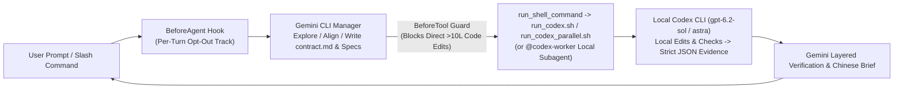

# Codex Orchestrator — Gemini CLI Edition (`gemini-cli` branch, `v2.1.0`)

A lightweight, native **Google Gemini CLI Extension** implementing the **Manager / Implementer Dual-Brain** workflow: **Gemini CLI** serves as the high-IQ **Principal Engineering Manager & Decision-Maker** (lighter and faster than heavy IDE harnesses), while **local OpenAI Codex CLI** serves as the **High-Execution Staff Implementer & Independent Reviewer**.

> Looking for the **Antigravity Plugin Edition**? Check the [`main`](https://github.com/yukki555/codex-orchestrator/tree/main) branch.

## Why Gemini CLI Harness (`gemini-cli` vs `main`)

* **Lower Orchestration Overhead**: Gemini CLI invokes `run_codex.sh` and `run_codex_parallel.sh` directly via `run_shell_command` (no mandatory intermediate worker hop unless you explicitly call `@codex-worker` to isolate verbose SSH/test logs).
* **No IDE Plan/Execute Switching Latency**: Single continuous Manager loop for codebase exploration, tradeoff alignment, contract authoring, parallel dispatch, and executive Chinese synthesis.
* **Identical High-Execution Codex Engine**: Shares the exact same `v2.1.0` `run_codex.sh`, `run_codex_parallel.sh`, and `codex-output-schema.json` core as `main` (decoupled `low`/`medium` -> `service_tier="fast"`, managed Git worktrees + `changes.patch` + `merge_check`, smart `review --structured`, `partial_progress` on timeout, zero-intrusion `--ignore-user-config --ignore-rules`).



## Prerequisites

1. **Google Gemini CLI** (`npm install -g @google/gemini-cli`), signed in with your Google account.
2. **OpenAI Codex CLI** (`codex` >= `0.171.0`, `npm install -g @openai/codex@latest`), signed in via `~/.codex`.
3. `python3` (`3.9+`), `git`, and macOS/Linux `bash` (`3.2+`).

## Installation

Install directly from this branch with Gemini CLI:

```bash
gemini extensions install https://github.com/yukki555/codex-orchestrator --ref gemini-cli
```

Or clone manually into `~/.gemini/extensions/`:

```bash
mkdir -p ~/.gemini/extensions
git clone -b gemini-cli https://github.com/yukki555/codex-orchestrator.git ~/.gemini/extensions/codex-orchestrator
```

## Built-in Workflows & Commands

| Entry Point | Purpose |
| :--- | :--- |
| Natural conversation | Persistent `GEMINI.md` rules + `BeforeAgent`/`BeforeTool` hooks enforce Manager/Implementer delegation automatically; include `skip codex` / `不用codex` / `你直接改` in a prompt to opt out for that turn. |
| `/codex:impl <task>` | Explore relevant code -> write `/tmp/codex-orchestrator/<task>/spec.md` -> run `run_codex.sh implement --structured` -> verify -> Chinese brief. |
| `/codex:review [focus]` | Capture uncommitted Git snapshot -> single-pass `run_codex.sh review --uncommitted --structured` -> spot-check `file:line` -> Chinese risk brief. |
| `/codex:dag <task>` | Author `contract.md` + disjoint module Specs + `manifest.json` -> `run_codex_parallel.sh` -> `merge_check` -> `git apply` -> parallel GPU/E2E verification & review -> Chinese brief. |
| `@codex-worker` | Isolated local subagent (`read_file`, `write_file`, `run_shell_command`; omits `replace`) for multi-round repair loops or remote SSH/GPU verification logs. |

## Direct CLI Examples

```bash
SCRIPTS=~/.gemini/extensions/codex-orchestrator/skills/codex-orchestrator/scripts

# 1. Default medium+fast structured implementation
"$SCRIPTS/run_codex.sh" implement \
  --dir "/path/to/repo" --add-dir "/path/to/tests" \
  --structured --timeout 240 \
  --spec /tmp/codex-orchestrator/task-1/spec.md \
  --out-dir /tmp/codex-orchestrator/task-1/implement

# 2. Single-pass structured Git diff review
"$SCRIPTS/run_codex.sh" review \
  --dir "/path/to/repo" --uncommitted --structured \
  --prompt "Check edge cases, numerical invariants, and backward compatibility." \
  --out-dir /tmp/codex-orchestrator/task-2/review

# 3. Parallel managed-worktree DAG implementation with manifest
"$SCRIPTS/run_codex_parallel.sh" \
  --out-dir /tmp/codex-orchestrator/task-3/parallel-impl \
  --mode implement --structured --max-parallel 3 \
  --dir "/path/to/repo" --timeout 240 \
  --manifest /tmp/codex-orchestrator/task-3/manifest.json
```

## Verification

Run the bundled standard-library extension regression suite:

```bash
python3 -m unittest discover -s ~/.gemini/extensions/codex-orchestrator/tests -p 'test_*.py' -v
```

## Repository Structure (`gemini-cli`)

| Path | Role |
| :--- | :--- |
| `gemini-extension.json` | Gemini CLI extension manifest (`v2.1.0`, points `contextFileName` to `GEMINI.md`) |
| `GEMINI.md` | Always-on Manager/Implementer playbook, DAG gate, and Chinese synthesis policy |
| `hooks/hooks.json` | Registers `BeforeAgent` (turn opt-out tracker) and `BeforeTool` (`codex-delegate-guard`) |
| `agents/codex-worker.md` | Local subagent definition (`kind: local`, `tools: [read_file, write_file, run_shell_command]`) |
| `commands/codex/{impl,review,dag}.toml` | Custom slash commands (`/codex:impl`, `/codex:review`, `/codex:dag`) |
| `skills/codex-orchestrator/SKILL.md` | Orchestration handbook and speed/budget routing matrix |
| `skills/codex-orchestrator/scripts/hook_delegate_guard.py` | Dual-mode `BeforeAgent`/`BeforeTool` (plus Antigravity `PreToolUse`) guard |
| `skills/codex-orchestrator/scripts/run_codex.sh` | Single-session Codex runner (`consult`/`implement`/`review`/`resume`) |
| `skills/codex-orchestrator/scripts/run_codex_parallel.sh` | Parallel DAG runner with managed Git worktrees, `changes.patch`, and `merge_check` |
| `skills/codex-orchestrator/references/` | Output JSON Schema, GPT-6.2 task Spec template, and executive brief template |
| `tests/test_gemini_cli_extension.py` | Unit tests covering manifest, hooks, TOML commands, subagent frontmatter, and guard decisions |
