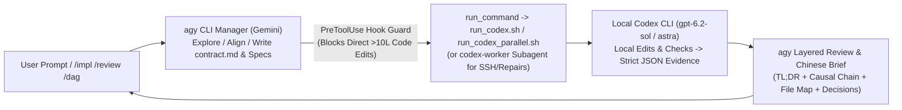

# Codex Orchestrator — Antigravity CLI (`agy`) Edition (`gemini-cli` branch, `v2.1.0`)

A native **Antigravity CLI (`agy`)** & App plugin implementing the **Manager / Implementer Dual-Brain** workflow: **Gemini in `agy`** acts as the lightweight terminal **Principal Engineering Manager & Decision-Maker**, while **local OpenAI Codex CLI** acts as the **High-Execution Staff Implementer & Independent Reviewer**.

> Looking for the original single-skill **`main`** branch? See [`main`](https://github.com/yukki555/codex-orchestrator/tree/main). Compared with `main`, this **`gemini-cli` (`agy` Edition)** branch keeps the identical `v2.1.0` core Codex engine (`run_codex.sh`, `run_codex_parallel.sh`, JSON Schema) and adds **`/impl`, `/review`, and `/dag` native slash skills** plus direct `agy` CLI (`run_command`) optimization.

## Architecture Overview



* **Lower Latency in Terminal (`agy` CLI)**: Invoke `run_codex.sh` and `run_codex_parallel.sh` directly via `run_command` for single-shot or DAG parallel tasks (eliminating unnecessary subagent round-trips), reserving `codex-worker` for multi-round repair loops or remote SSH/GPU logs.
* **Bundled Slash Skills**: Ships **`/impl`**, **`/review`**, and **`/dag`** directly alongside `codex-orchestrator`, `AGENTS.md`, `hooks.json`, and `codex-worker`.
* **Zero-Intrusion Codex Execution**: Defaults to `--ignore-user-config` and `--ignore-rules` (reusing `~/.codex` login while preserving Codex Desktop settings), `low`/`medium` effort -> `service_tier="fast"`, managed Git worktrees + `changes.patch` + stacked `merge_check`, smart `review --structured`, and `partial_progress` telemetry.

## Prerequisites & Installation

1. Install **Antigravity CLI (`agy`)**:
   ```bash
   curl -fsSL https://antigravity.google/cli/install.sh | bash
   ```
2. Ensure **OpenAI Codex CLI** (`codex` >= `0.171.0`) is installed and signed in (`~/.codex`).
3. Clone this branch into your global Antigravity plugins directory:
   ```bash
   mkdir -p ~/.gemini/config/plugins
   git clone -b gemini-cli https://github.com/yukki555/codex-orchestrator.git ~/.gemini/config/plugins/codex-orchestrator
   ```
4. Verify discovery:
   ```bash
   agy plugin list
   # Expected: codex-orchestrator (enabled, 2.1.0) — 4 skills, 1 agent, 1 rule, 1 hook
   ```

## Recommended `agy` CLI Settings (Turbo / Auto)

To avoid repetitive approval prompts when `agy` runs `run_codex.sh`, `run_codex_parallel.sh`, or SSH verification commands, configure `~/.gemini/antigravity-cli/settings.json`:

* **Turbo equivalent** (no sandbox limits, fast SSH & cross-dir workflows):
  ```json
  {
    "toolPermission": "always-proceed",
    "agentMode": "accept-edits",
    "allowNonWorkspaceAccess": true,
    "enableTerminalSandbox": false,
    "artifactReviewPolicy": "always-proceed"
  }
  ```
* **Balanced `auto` mode** (sandboxed commands auto-run; risky host ops evaluated automatically):
  ```json
  {
    "agentMode": "auto",
    "enableTerminalSandbox": true,
    "allowNonWorkspaceAccess": true
  }
  ```

Or launch one-off Turbo sessions via `agy --dangerously-skip-permissions`.

## Slash Skills & CLI Usage

| Command / Feature | Purpose |
| :--- | :--- |
| `/impl <task>` | Explore relevant code -> write `/tmp/codex-orchestrator/<task>/spec.md` -> `run_codex.sh implement --structured` -> verify -> Chinese brief. |
| `/review` | Inspect uncommitted Git changes in one structured pass (`run_codex.sh review --uncommitted --structured`) + spot-check `file:line` -> Chinese risk brief. |
| `/dag <task>` | Stage 0 `contract.md` + manifest -> Stage 1 `run_codex_parallel.sh` managed worktrees + `merge_check` -> `git apply` -> Stage 2 integration -> Stage 3 parallel test & review. |
| `codex-worker` | Subagent for multi-round repair loops (`<= 2` rounds) or remote SSH/GPU tests (inspect via `/agents` & `/tasks`). |
| TUI rhythm | Use `/plan` or `/grill-me` to align first, `Shift+Tab` to switch modes, `/diff` to review changes, and `/compact` after milestones. Include `不用codex` / `skip codex` to opt out for a turn. |

### Direct CLI Examples

```bash
SCRIPTS=~/.gemini/config/plugins/codex-orchestrator/skills/codex-orchestrator/scripts

# 1. Default medium+fast structured implementation
"$SCRIPTS/run_codex.sh" implement \
  --dir "/path/to/repo" --add-dir "/path/to/tests" \
  --structured --timeout 240 \
  --spec /tmp/codex-orchestrator/task-1/spec.md \
  --out-dir /tmp/codex-orchestrator/task-1/implement

# 2. Single-pass structured Git diff review
"$SCRIPTS/run_codex.sh" review \
  --dir "/path/to/repo" --uncommitted --structured \
  --prompt "Check edge cases, numerical invariants, and backward compatibility." \
  --out-dir /tmp/codex-orchestrator/task-2/review

# 3. Parallel managed-worktree DAG implementation with manifest
"$SCRIPTS/run_codex_parallel.sh" \
  --out-dir /tmp/codex-orchestrator/task-3/parallel-impl \
  --mode implement --structured --max-parallel 3 \
  --dir "/path/to/repo" --timeout 240 \
  --manifest /tmp/codex-orchestrator/task-3/manifest.json
```

## Verification

Run the bundled standard-library test suite:

```bash
python3 -m unittest discover -s ~/.gemini/config/plugins/codex-orchestrator/tests -p 'test_*.py' -v
```

## Repository Structure (`gemini-cli` / `agy` Edition)

| Path | Role |
| :--- | :--- |
| `plugin.json` | Antigravity plugin manifest (`v2.1.0`) |
| `hooks.json` | Root `PreToolUse` hook registration (`codex-delegate-guard`) |
| `rules/AGENTS.md` | Always-on Manager/Implementer delegation, DAG gate, and Chinese synthesis policy |
| `agents/codex-worker.md` | Dedicated Codex execution & verification subagent |
| `skills/codex-orchestrator/SKILL.md` | Full orchestration handbook (`v2.1`) |
| `skills/{impl,review,dag}/SKILL.md` | Bundled `/impl`, `/review`, and `/dag` slash skills |
| `skills/codex-orchestrator/scripts/` | `run_codex.sh`, `run_codex_parallel.sh`, and `hook_delegate_guard.py` |
| `skills/codex-orchestrator/references/` | Strict output JSON Schema, GPT-6.2 task Spec template, and executive brief template |
| `tests/test_agy_plugin.py` | Unit tests covering manifests, `hooks.json`, `agents`, 4 skills, script parity/syntax, and hook guard |
