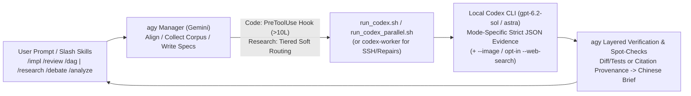

# Codex Orchestrator — Antigravity CLI (`agy`) Edition (`gemini-cli` branch, `v3.0.0`)

A native **Antigravity CLI (`agy`)** & App plugin implementing a **General-Purpose Dual-Brain Orchestration** workflow: **Gemini in `agy`** acts as **Principal Manager, Corpus Collector & Decision-Maker**, while **local OpenAI Codex CLI** acts as **High-Execution Staff Implementer, Independent Reviewer & Red-Team Analyst** across both **coding** (`/impl`, `/review`, `/dag`) and **research / debate / experiment analysis** (`/research`, `/debate`, `/analyze`).

> Looking for the Antigravity Desktop **`main`** branch? See [`main`](https://github.com/yukki555/codex-orchestrator/tree/main). This **`gemini-cli` (`agy` Edition)** branch keeps full backward compatibility with all `v2.1.0` coding workflows and upgrades to **`v3.0.0`** with pluggable non-code profiles (`research`, `critique`, `analyze`), 3 new strict JSON schemas, recursive schema validation, `--image` multimodal attachment, opt-in `--web-search`, and `/research`, `/debate`, `/analyze` slash skills.

## Architecture Overview



* **General-Purpose Pluggable Profiles**:
  * **Coding**: `implement`, `consult`, `review`, `resume` with `codex-output-schema.json`, managed Git worktrees + `changes.patch` + stacked `merge_check`, and `PreToolUse` `codex-delegate-guard`.
  * **Research / Red-Team / Data Analysis**: `research`, `critique`, `analyze` (read-only sandbox, works in non-Git `corpus/` directories) with dedicated strict JSON schemas (`research-output-schema.json`, `critique-output-schema.json`, `analysis-output-schema.json`), `--image` chart/figure attachment, and opt-in `--web-search` (`codex --search exec`).
* **Lower Latency in Terminal (`agy` CLI)**: Invoke `run_codex.sh` and `run_codex_parallel.sh` directly via `run_command` for single-shot or DAG parallel tasks, reserving `codex-worker` for multi-round repair loops or remote SSH/GPU logs.
* **Zero-Intrusion Codex Execution**: Defaults to `--ignore-user-config` and `--ignore-rules` (reusing `~/.codex` login while preserving Codex Desktop settings), offline frozen corpora by default, `low`/`medium` effort -> `service_tier="fast"`, and `partial_progress` telemetry.

## Prerequisites & Installation

1. Install **Antigravity CLI (`agy`)**:
   ```bash
   curl -fsSL https://antigravity.google/cli/install.sh | bash
   ```
2. Ensure **OpenAI Codex CLI** (`codex` >= `0.171.0`) is installed and signed in (`~/.codex`).
3. Clone this branch into your global Antigravity plugins directory:
   ```bash
   mkdir -p ~/.gemini/config/plugins
   git clone -b gemini-cli https://github.com/yukki555/codex-orchestrator.git ~/.gemini/config/plugins/codex-orchestrator
   ```
4. Verify discovery:
   ```bash
   agy plugin list
   # Expected: codex-orchestrator (enabled, 3.0.0) — 7 skills, 1 agent, 1 rule, 1 hook
   ```

## Recommended `agy` CLI Settings (Turbo / Auto)

To avoid repetitive approval prompts when `agy` runs `run_codex.sh`, `run_codex_parallel.sh`, or SSH verification commands, configure `~/.gemini/antigravity-cli/settings.json`:

* **Turbo equivalent** (no sandbox limits, fast SSH & cross-dir workflows):
  ```json
  {
    "toolPermission": "always-proceed",
    "agentMode": "accept-edits",
    "allowNonWorkspaceAccess": true,
    "enableTerminalSandbox": false,
    "artifactReviewPolicy": "always-proceed"
  }
  ```
* **Balanced `auto` mode** (sandboxed commands auto-run; risky host ops evaluated automatically):
  ```json
  {
    "agentMode": "auto",
    "enableTerminalSandbox": true,
    "allowNonWorkspaceAccess": true
  }
  ```

Or launch one-off Turbo sessions via `agy --dangerously-skip-permissions`.

## Slash Skills & CLI Usage

| Command / Feature | Category | Purpose |
| :--- | :--- | :--- |
| `/impl <task>` | Code | Explore relevant code -> write `spec.md` -> `run_codex.sh implement --structured` -> verify -> Chinese brief. |
| `/review` | Code | Inspect uncommitted Git changes in one structured pass (`run_codex.sh review --uncommitted --structured`) + spot-check `file:line` -> Chinese risk brief. |
| `/dag <task>` | Code | Stage 0 `contract.md` + manifest -> Stage 1 `run_codex_parallel.sh` managed worktrees + `merge_check` -> `git apply` -> Stage 2 integration -> Stage 3 parallel test & review. |
| `/research <topic>` | General | Stage 0 freeze web/local sources into `corpus/` -> Stage 1 parallel Codex `research` (+ Antigravity `research`/`browser`) -> Stage 2 optional blind `critique` -> Stage 3 source spot-check & Chinese decision brief. |
| `/debate <proposal>` | General | Neutralize proposal (strip author bias) -> independent Codex `critique` red-team pass -> adjudicate P0/P1 challenges -> Chinese decision matrix. |
| `/analyze <exp>` | Research / Data | Collect local/remote logs & plots into `corpus/` -> Codex `analyze` (+ `--image`) checking theory/code/metrics consistency -> spot-check numbers -> Chinese brief. |
| `codex-worker` | Subagent | Isolates multi-round repair loops (`<= 2` rounds) or remote SSH/GPU tests (inspect via `/agents` & `/tasks`). |

### Direct CLI Examples

```bash
SCRIPTS=~/.gemini/config/plugins/codex-orchestrator/skills/codex-orchestrator/scripts

# 1. Default medium+fast structured implementation
"$SCRIPTS/run_codex.sh" implement \
  --dir "/path/to/repo" --add-dir "/path/to/tests" \
  --structured --timeout 240 \
  --spec /tmp/codex-orchestrator/task-1/spec.md \
  --out-dir /tmp/codex-orchestrator/task-1/implement

# 2. Structured deep research on a frozen non-Git corpus (+ optional chart & opt-in live search)
"$SCRIPTS/run_codex.sh" research \
  --dir /tmp/codex-orchestrator/topic-1/corpus --structured --ephemeral \
  --image /tmp/codex-orchestrator/topic-1/corpus/chart.png \
  --spec /tmp/codex-orchestrator/topic-1/spec-research.md \
  --out-dir /tmp/codex-orchestrator/topic-1/research

# 3. Blind red-team critique with high effort + fast tier
"$SCRIPTS/run_codex.sh" critique \
  --dir /tmp/codex-orchestrator/debate-1 --structured --effort high --speed fast --ephemeral \
  --spec /tmp/codex-orchestrator/debate-1/spec-critique.md \
  --out-dir /tmp/codex-orchestrator/debate-1/critique

# 4. Parallel heterogeneous research + critique (or worktree implement) manifest
"$SCRIPTS/run_codex_parallel.sh" \
  --out-dir /tmp/codex-orchestrator/topic-1/parallel \
  --mode research --structured --max-parallel 3 \
  --dir /tmp/codex-orchestrator/topic-1/corpus --timeout 240 \
  --manifest /tmp/codex-orchestrator/topic-1/manifest.json
```

## Verification

Run the bundled standard-library test suite:

```bash
python3 -m unittest discover -s ~/.gemini/config/plugins/codex-orchestrator/tests -p 'test_*.py' -v
```

## Repository Structure (`gemini-cli` / `agy` Edition)

| Path | Role |
| :--- | :--- |
| `plugin.json` | Antigravity plugin manifest (`v3.0.0`) |
| `hooks.json` | Root `PreToolUse` hook registration (`codex-delegate-guard`, code writes only) |
| `rules/AGENTS.md` | Always-on Dual-Brain delegation, tiered research routing, DAG gate, and Chinese synthesis policy |
| `agents/codex-worker.md` | Dedicated Codex execution & verification subagent |
| `skills/codex-orchestrator/SKILL.md` | Full orchestration handbook (`v3.0`) |
| `skills/{impl,review,dag,research,debate,analyze}/SKILL.md` | Bundled slash skills covering code & general research/debate/analysis workflows |
| `skills/codex-orchestrator/scripts/` | `run_codex.sh`, `run_codex_parallel.sh`, and `hook_delegate_guard.py` |
| `skills/codex-orchestrator/references/` | 4 strict JSON schemas (`codex`, `research`, `critique`, `analysis`), Spec templates, and Template A/B brief templates |
| `tests/test_agy_plugin.py` | Unit tests covering manifests, `hooks.json`, `agents`, 7 skills, 4 schemas, stub-Codex CLI/parallel routing, and hook guard |
